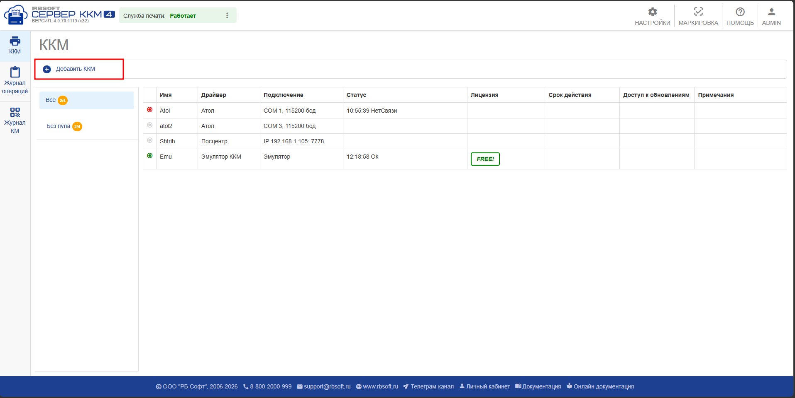
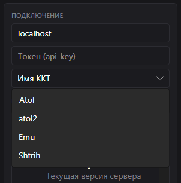
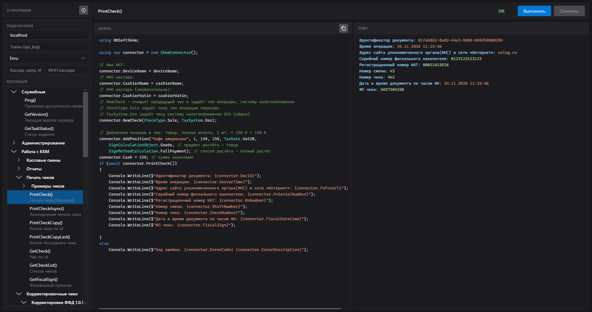

# Демо приложение SkkmConnector

Настольное приложение, которое показывает возможности библиотеки
[`SkkmConnector`](https://github.com/rbsoft/SKKMConnector) вживую:
для каждого метода коннектора есть готовый пример — его **исходный код** видно на экране, а **ответ сервера** приходит после нажатия «Выполнить».

По сути это интерактивный справочник: слева — дерево примеров по группам API, справа — что отправляем в коннектор и что получаем от Сервера ККМ.

# Требования

**.NET 6 SDK** (`net6.0`).  
**Сервер ККМ 4** — служба печати (по умолчанию `localhost:4398`).  
**NuGet-пакет `SkkmConnector`** — в демо подключена актуальная версия из локального `nupkg`.

# Настройка среды

Ниже — минимальная подготовка Сервера ККМ и кассы, чтобы демо могло печатать чеки.

## 1. Сервер ККМ

Установите и запустите **Сервер ККМ 4**.  
Откройте админ-панель в браузере: `http://localhost:8866`  
(или `http://127.0.0.1:8866`).  
Войдите учётной записью по умолчанию: **Admin** / **Admin**.  
Пароль лучше сразу сменить в разделе «Пользователи».


## 2. Добавление кассы (ККТ)

1. В панели Сервера ККМ откройте раздел **ККМ**, затем **Добавить ККМ**.



2. Задайте **имя устройства** — то же имя потом укажите в демо (поле «Имя ККТ»), например `Emu` или `Emulator`.
3. Выберите **тип драйвера**. Для проверки без железа удобен **Эмулятор ККМ**.


4. Укажите подключение (COM или TCP) и пароль устройства, если драйвер его требует.
5. После сохранения включите переключатель **«Использовать»**. Если связь с реальной кассой не устанавливается, устройство не включится — проверьте COM-порт или IP и драйвер производителя (Атол, Штрих и т.д.).


Для примеров маркировки откройте ККМ, вкладку «Маркировка», и в разделе «ТС ПИоТ» укажите адрес и порт.


Затем в панели «Настройка драйвера» включите работу с ТС ПИоТ и сохраните изменения.  
**Атол** — в поле «GRPC порт» укажите порт для подключения ТС ПИоТ к драйверу (по умолчанию `4041`).


**Пос-Центр** — установите флажок «Работа с ТС ПИоТ».


Драйверы для работы с ТС ПИоТ необходимо получать из личного кабинета ЕСП.

# Установка

Для начала работы нужен проект демо и пакет `SkkmConnector` (см. `PackageReference` в `SkkmNugetSample.csproj`, версия например `1.34.31`).

```powershell
cd DemoSKKMConnector
dotnet restore
dotnet run
```

Либо откройте решение в Visual Studio / Rider и запустите (`F5`).  
Сервер ККМ должен быть запущен, касса добавлена и доступна.

# "Подключение"


- Address (обяз.) — адрес сервера ККМ, можно писать с указанием порта через двоеточие (`localhost:4398`).
- Token (не обяз.) — токен для авторизации пользователя (`api_key`). Не используется при включённом «Анонимный доступ» в настройках пользователей Сервера ККМ.
- DeviceName (обяз.) — имя ККМ.

В выпадающем списке DeviceName показываются ККМ, доступные на сервере:



Кнопка «!» в блоке «О программе» открывает справку в PDF.

# "Методы"


Для каждого метода отображаются свои поля для заполнения. Например, для печати чека:

- CashierName — ФИО кассира.
- CashierVatin (не обяз.) — ИНН кассира.

Справа сверху — статус выполнения и кнопка **«Выполнить»**. Рядом **«Отменить»** прерывает выполняющийся запрос. После «Выполнить» запрос уходит на Сервер ККМ.

Под наименованием метода — поле с C#-кодом, который выполнится. Кнопка копирования в правом верхнем углу копирует код в буфер.

Справа — вывод примера: переменные, которые изменились после успешного запроса:

- DocId — идентификатор документа
- ShiftNumber — номер смены
- CheckNumber — номер чека
- FiscalDatetime — дата и время документа по часам ФН
- FiscalSign — фискальный признак документа



Для методов с отчётами (`CloseShift`, `GetTotals`, `GetOverall` и т.п.) в ответе дополнительно выводится таблица счётчиков `Counters`.
