# Демо приложение SkkmConnector

Декстопное приложение, которое показывает возможности библиотеки
[`SkkmConnector`](https://github.com/rbsoft/SKKMConnector): для каждого
метода коннектора есть готовый пример - его **исходный код** видно на экране, а
**ответ сервера** приходит после нажатия «Выполнить».

По сути это интерактивный справочник: слева - дерево примеров по группам API,
справа - что отправляем в коннектор и что получаем от Сервера ККМ.

В блоке **О программе** кнопка со значком «!» открывает эту справку в PDF.

---

## Содержание

- [Возможности](#возможности)
- [Требования](#требования)
- [Настройка среды](#настройка-среды) 
- [Запуск](#запуск)
- [Интерфейс приложения](#интерфейс-приложения)
- [Как устроены примеры](#как-устроены-примеры)
- [Особенности печати чеков](#особенности-печати-чеков)
- [Добавить свой пример](#добавить-свой-пример)
- [Стек](#стек)

---

## Возможности

- **Группы REST API** - примеры в дереве по структуре Сервера ККМ: авторизация,
  администрирование, кассовые смены, отчёты, печать чеков, коррекции, денежный
  ящик, нефискальные чеки, очередь, маркировка.
- **Код запроса** - в панели «Запрос» реальный C#-код примера с подсветкой.
- **Ответ сервера** - в панели «Ответ» то, что напечатал пример (`Console.WriteLine`).
- **Живой сервер** - примеры обращаются к Серверу ККМ по указанному адресу.

---

## Требования

- **.NET 6 SDK** (`net6.0`).
- **Сервер ККМ 4.0** - служба печати (по умолчанию `localhost:4398`).
- **NuGet-пакет `SkkmConnector`** - в демо подключена актуальная версия из
  локального `nupkg` / источника пакета.

---

## Настройка среды

Перед запуском демо нужно подготовить Сервер ККМ: войти в веб-консоль, добавить
ККМ и, для примеров с маркировкой, настроить ТС ПИоТ.

### 1. Вход в веб-консоль

Откройте [`http://127.0.0.1:8866/`](http://127.0.0.1:8866/) и войдите. При первом
запуске доступна учётная запись `Admin` с паролем `Admin`.

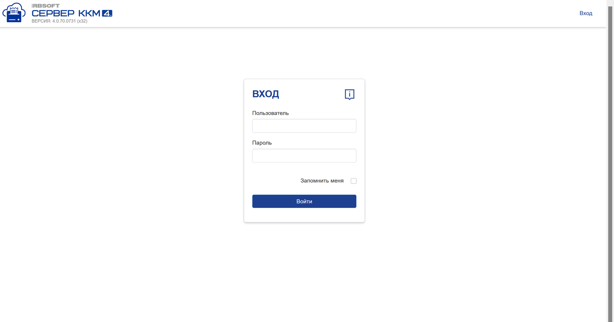

### 2. Добавление ККМ

В разделе «ККМ» нажмите «Добавить ККМ».


Укажите наименование, тип драйвера и подключение (COM или TCP). Для проверки без
кассы выберите драйвер «Эмулятор ККМ». Наименование ККМ указывается в демо в поле
«Имя ККТ».

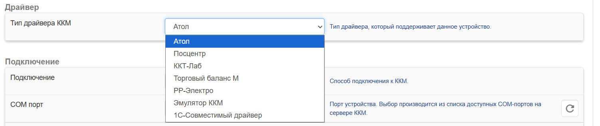

После сохранения включите переключатель «Использовать».

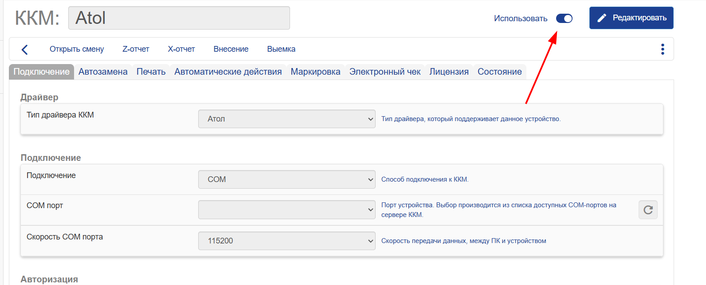

### 3. REST API и токен

Демо обращается к REST API Сервера ККМ на порту `4398` (адрес в демо, например
`localhost:4398`). Если анонимный доступ к REST API выключен, укажите в демо
токен (`api_key`).

### 4. Маркировка в ККМ

ТС ПИоТ настраивается для каждой ККМ отдельно. Откройте ККМ и перейдите на
вкладку «Маркировка». В разделе «ТС ПИоТ» укажите адрес и порт ТС ПИоТ.

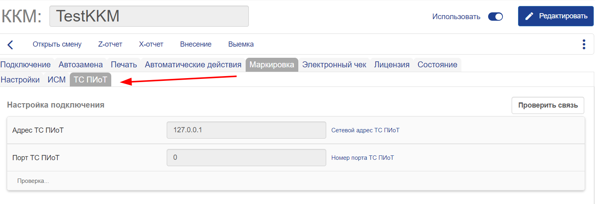

Затем в панели «Настройка драйвера» включите работу с ТС ПИоТ в зависимости от
драйвера и сохраните изменения.

**Атол** - в поле «GRPC порт» укажите порт для подключения ТС ПИоТ к драйверу
(по умолчанию `4041`).

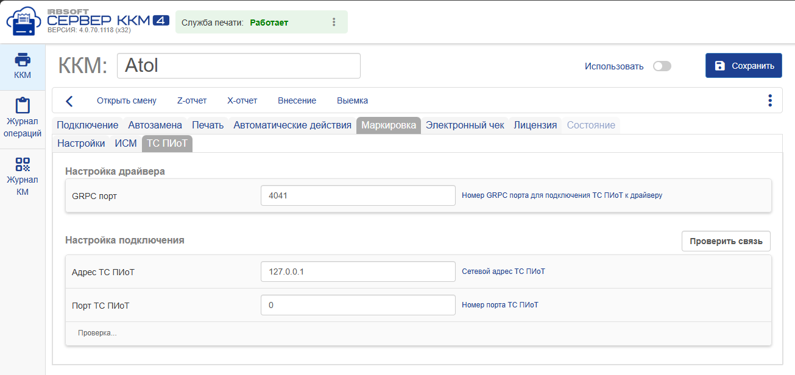

**Пос-Центр** — установите флажок «Работа с ТС ПИоТ».

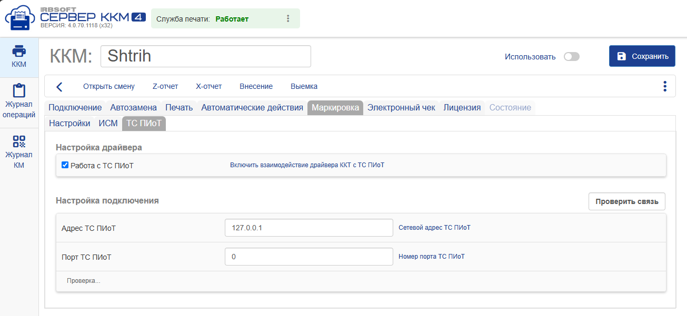

> **Примечание.** Драйверы для работы с ТС ПИоТ необходимо получать из личного
> кабинета ЕСП.

---

## Запуск

1. Убедитесь, что пакет `SkkmConnector` доступен проекту (см. `PackageReference`
   в `SkkmNugetSample.csproj`, версия например `1.34.28`).
2. Восстановите зависимости и запустите:

```powershell
cd DemoSKKMConnector
dotnet restore
dotnet run
```

Либо откройте решение в Visual Studio / Rider и запустите (`F5`).

3. Сервер ККМ должен быть запущен, касса добавлена и доступна.

---

## Интерфейс приложения

Окно разделено на три части: слева - подключение и коллекция примеров, в центре -
код запроса, справа - ответ сервера.

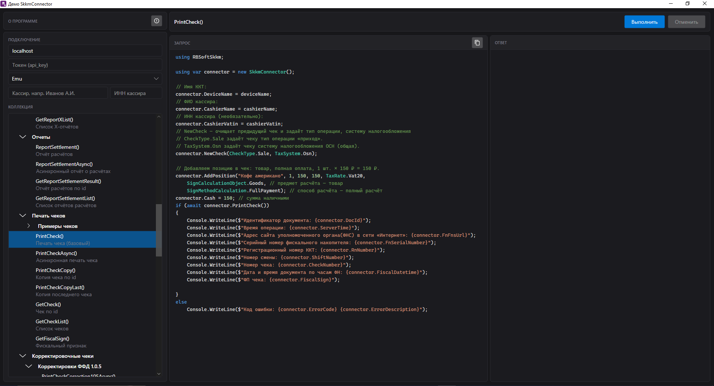

### Левая панель: подключение и коллекция

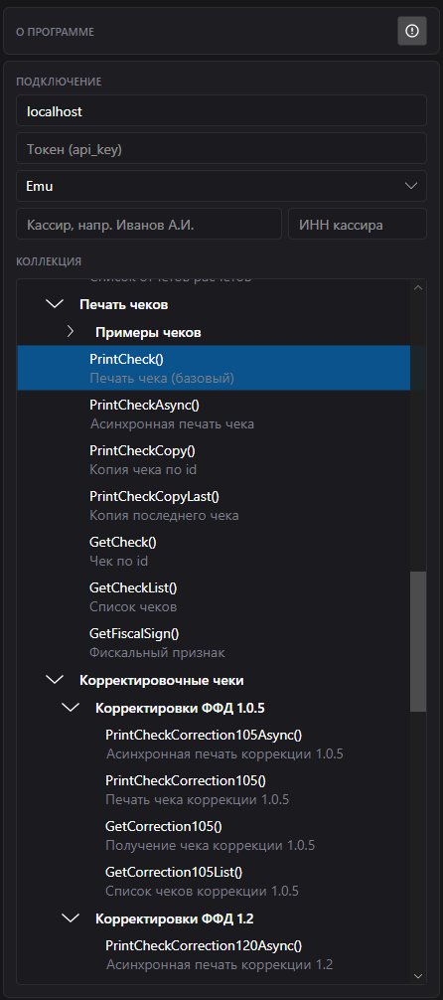

- **О программе** — кнопка «!» открывает справку в PDF.
- **Подключение** — те же параметры, что у `SkkmConnector`:

| Поле | Пример | Свойство коннектора |
| ---- | ------ | ------------------- |
| Адрес | `localhost` или `localhost:4398` | `Address` |
| Токен | `api_key` | `Token` |
| Имя ККТ | `Emu` | `DeviceName` |
| Кассир / ИНН | Иванов А.И. | `CashierName` / `CashierVatin` |

Список ККТ подтягивается с сервера при открытии выпадающего списка.

- **Коллекция** - дерево примеров по группам REST API. У каждого пункта сверху
  имя вызываемого метода коннектора (`PrintCheck()`), под ним - короткое описание.

### Дополнительные поля примера

Когда выбранному примеру нужны параметры, в панели «Подключение» появляются
дополнительные поля: период «С / По», номер смены, признак обработки, id
документа, коды маркировки, сумма. Незаполненные необязательные поля
в запрос не передаются.

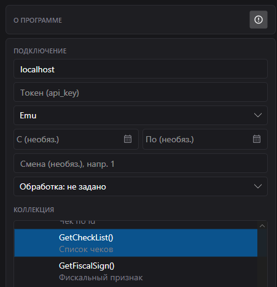

### Панель «Запрос»

В центре - C#-код примера в том виде, в каком его пишут в клиентском приложении.
Кнопка копирования в правом верхнем углу копирует код в буфер. Сверху - кнопки
**«Выполнить»** и **«Отменить»** (прерывает выполняющийся запрос).

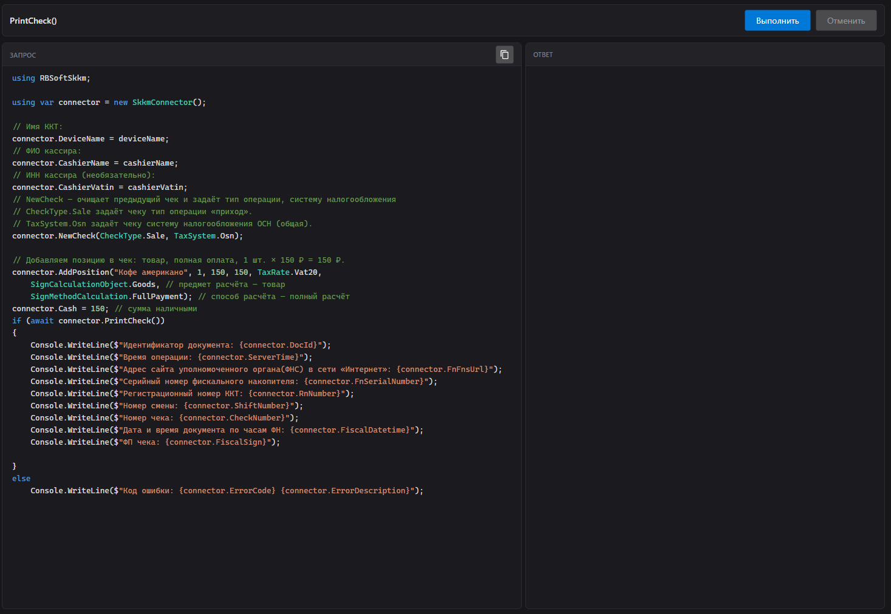

### Панель «Ответ»

Справа - всё, что пример вывел через `Console.WriteLine`. Рядом с кнопками
показывается статус выполнения.

Успешный ответ - статус **OK**, поля результата:

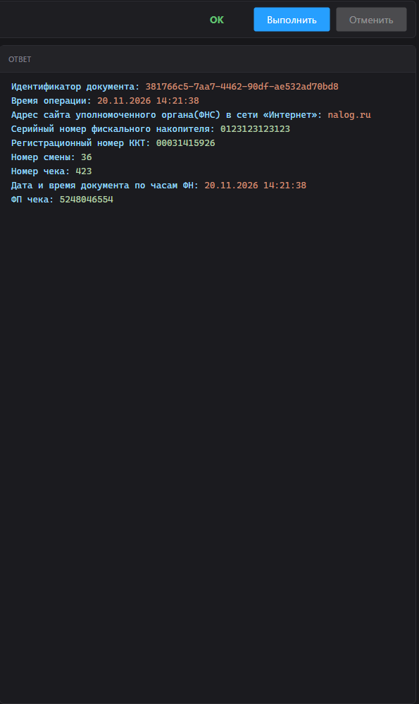

Ошибка - статус **Error**, код и описание ошибки от Сервера ККМ
(`ErrorCode` / `ErrorDescription`), например «55 Требуется открытая смена»:

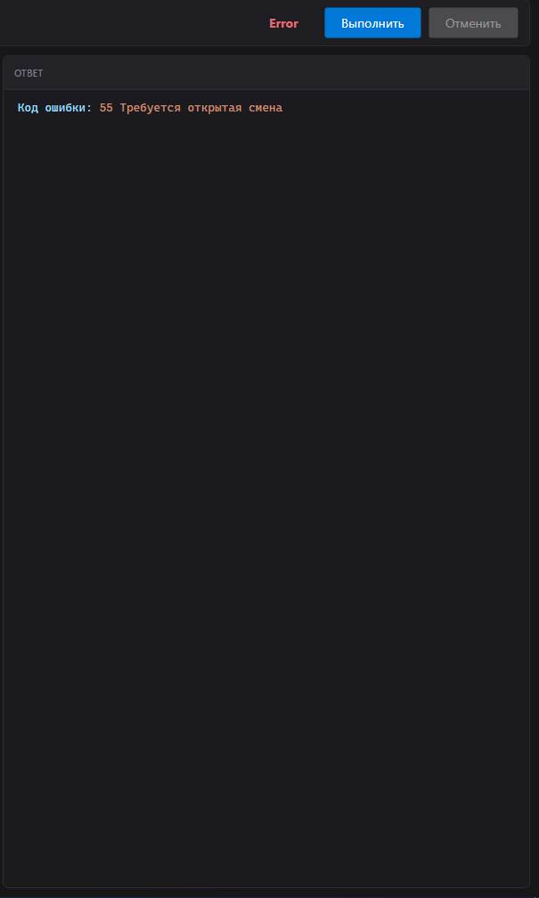

---

## Как устроены примеры

Все примеры лежат в `Examples/` и копируются в вывод сборки, чтобы панель
«Запрос» показала исходный код.

При старте приложение находит классы-наследники `Sample` и строит дерево.
В панели «Запрос» пример выглядит как обычный клиентский код:

```csharp
using RBSoftSkkm;

using var connector = new SkkmConnector();
connector.DeviceName = deviceName;
// …
await connector.PrintCheck();
```

- **`GroupPath`** - путь в дереве (`|`).
- **`Title`** - название в дереве.
- **Метод** - заполняет `SkkmConnector` и вызывает API; адрес, токен, касса и
  кассир подставляются из панели через поля `Sample`.

---

## Добавить свой пример

Создайте `.cs` в подходящей папке `Examples/` - класс-наследник `Sample` с
`GroupPath`, `Title` и методом `Task<SkkmConnector>`. После пересборки пример
появится в дереве сам.

Полное описание API - в README репозитория коннектора и в `Методы.md`.

---

## Стек

- **Avalonia 11** - интерфейс.
- **Material.Icons.Avalonia** - иконки.
- **SkkmConnector** - библиотека `RBSoftSkkm`.
- **.NET 6**.

**Разработчик:** RBSoft · [rbsoft.ru](https://rbsoft.ru) ·
[online@rbsoft.ru](mailto:online@rbsoft.ru)
